# Functional Specifications: Project Mayflower

| | |
| --- | --- |
| **Project Name** | Project Mayflower |
| **Status** | Draft |
| **Team** | Mayflower |
| **Authors** | Noah Levine, Caleb Weisgerber, Ryan Massenburg, Emmett Oliver |
| **Last Updated** | 10/30/2026 |

> **Reading this draft:** Items marked **[OPEN]** still need a team decision and are tracked in [Appendix B](#appendix-b-issues-list). Items marked **[PROPOSED]** are suggested defaults that need confirmation. Remove both markers once they are agreed.

## Latest Changes

The full revision history is tracked in the GitHub commit history.

**Last updated 10/30/2026** (Emmett Oliver)

- Revised section 1.2 in accordance with in-class feedback and new Nov 3 assignment.
- Moved Opening Placement Reviewer to Phase 2 in light of current state of progress.

## Table of Contents

1. [Introduction](#1-introduction)
2. [Product Overview](#2-product-overview)
3. [Requirements](#3-requirements)
- [Appendix A. Analysis Models](#appendix-a-analysis-models)
- [Appendix B. Issues List](#appendix-b-issues-list)

---

## 1. Introduction

### 1.1 Purpose

This document specifies the functional, interface, and behavioral requirements for Project Mayflower, a web-based game reviewer and practice platform for Settlers of Catan. It works like Chess.com's Game Review, but for Catan. Players upload recorded games to find their mistakes and learn how to fix them. The tool helps players spot critical blunders, try out alternative lines, and practice both set-up positions and full games against AI opponents.

This specification covers:
- overall architecture;
- API contracts;
- background simulation job interfaces;
- data capture schemas;
- automated validation gates across the three-quarter engineering lifecycle.

It sets acceptance criteria for deciding when deliverables are complete, and ensures the system meets the course requirements.

### 1.2 Scope

The platform is a web-based teaching and analysis tool. It helps players analyze their opening placements and the choices they make throughout the game, and lets them practice against a range of AI opponents.

Project Mayflower works as a post-game review suite and a sparring engine:
1. A client-side extension records match data from the player's own games on Colonist.io.
2. The move stream is fed into our Game Engine.
3. The system calculates how each move changed the player's win probability and suggests stronger alternative moves.

The platform targets **base-game, 4-player Catan only**, and includes **player-to-player trading**, even though other players' cards are hidden.

#### In scope

**Core User Scenario:**

- **Match Recording & Ingestion:** The user captures a standard 4-player Colonist.io match via the read-only extension for Chromium-based browsers (UI-01) and uploads the session export to the web application (UI-02).
- **Setup Evaluation:** The platform uses the Game Engine to replay the opening phase, ranking initial settlements and road trajectories against candidate options based on production potential, resource balance, and port synergies (see FR-03 for what "replay" can guarantee under hidden information).
- **Decision & Blunder Analysis:** The player inspects key turning points, viewing move-by-move shifts in estimated win probabilities and plain-language explanations of strategic inaccuracies.
- **Targeted Sparring:** The player transitions into a sandbox environment powered by the Game Engine (UI-06) to replay crucial game states or test alternative strategies from any point in the game against calibrated AI bot archetypes.

**Phase 1: Core Prototype**

- **Session Recording (FR-01, UI-01):** The user records their live Colonist.io match via a read-only browser extension, observing active recording badges (REC, PAUSE, ERR) and downloading the session export. *(Built.)*
- **Match Ingestion & Board Replay (FR-02, FR-03, UI-02, UI-03):** The user drags and drops a recorded session into the web app. The system alerts the user to missing turns or corruption, and renders the turn-by-turn board state, dice rolls, and public card counts.
- **Imperfect Information Filtering (FR-05):** The user is assured an authentic review; opponent hidden hands and unplayed development cards are masked from analysis routines to prevent unrealistic omniscient evaluation.
- **Bot Evaluation Foundation & Standardized Benchmarks (FR-06):** Delivers the common bot execution interface along with an initial random baseline and benchmark bot implementation executing within turn time limits. This satisfies the user's need for objective, automated move assessments in the Opening Placement Review, while establishing the core AI architecture required for the full 4-Player Sparring Mode and Move-by-Move Review (Phase 2, FR-7, FR-08, FR-09).

[OPEN] I-5: Phase 1 may be overloaded. The Game Engine and the bots are the Q1 priority. The Opening Reviewer, Review UI and job queue may move to Phase 2.

**Phase 2: Minimum Viable Product**

- **Opening Placement Reviewer (FR-07, UI-04):** The user inspects their opening settlements and roads. The system ranks legal candidate locations, highlights resource starvation risks, scores port synergies, and explains why specific locations were strategically superior.
- **Move-by-Move Review (FR-08, UI-05):** The user steps through their match using keyboard arrow keys or timeline scrubbing. The interface charts an interactive win-probability graph, assigns qualitative grades to decisions, shows risks of being starved of resources, and flags counterproductive moves such as feeding the table leader.
- **Basic Trade Utility & Leader-Threat Model:** The user sees scores per trade offer based on its value to the player and weighed against how much it advances the table leader.
- **Variance-Aware Grading & Calibration (FR-13):** When two moves have near-identical outcomes, the user sees an "About Equal" badge explaining that the difference is within normal dice variance.
- **4-Player Sparring Mode (FR-09, UI-06):** The user plays complete 4-player games against three bots.
- **Responsive Background Processing (NFR-02, NFR-03, NFR-05):** The user experiences an unblocked, responsive web client with real-time progress indicators while computational rollouts run asynchronously.
- **Account History & Session Tracking (FR-12, UI-07):** The user creates an account to save practice matches, access past reviews, and track learning progress over time.

**Phase 3: Extensions / Advanced Capabilities**

- **What-If Branching (FR-14, UI-08):** The user freezes the game at any turn and can try different moves and compare simulated outcomes branch by branch (like Git branches for a Catan game).
- **Structured Table-Talk & Persuasion:** The user practices negotiation with bot opponents who provide game-state-grounded messages to propose trades, point out the table leader, or stay quiet (avoid unwanted attention).
- **Configurable Bot Play Styles:** The user picks and practices against bots with different play styles: how it trades, whom it targets, whether it holds grudges, and how predictable it is. Each bot's game plan (e.g. ore/wheat/sheep, wood/brick, ports and trading) comes from its board position and seat.
- **The Arena:** The user views automated bot-vs-bot tournaments with Elo ratings, including benchmarks against external bots.
- **Cloud Scaled Storage (NFR-06):** The user experiences rapid review turnarounds backed by cloud architecture and reliable storage for historical game archives.

#### Out of scope

- **Automated platform scraping or active injection:** The system never injects gameplay scripts, makes moves on third-party servers, scrapes lobbies, or captures data from other people's accounts. The Collector runs only client-side and read-only, in the user's own browser session.
- **Autonomous bot play on Colonist or other Catan sites, or live in-game advice:** Bots never play on Colonist. Real-player testing (Phase 2) is done by a human team member entering the bot's suggested moves, for evaluation only. The platform does not advise users during their normal Colonist games.
- **Human-vs-human online multiplayer:** The platform does not support games between human users or matchmaking lobbies. Each practice game consists of one human player and three AI opponents. In-game chat is limited to communication between the player and the AI opponents.
- **1v1 / 2-player games:** 2-player Catan plays differently. The platform supports 4-player games only.
- **Complete game-theoretic solution:** Catan has dice, hidden information and open negotiation, so the bot does not claim to play optimally. It relies on search and learned evaluation.
- **Native mobile apps:** No iOS or Android apps. The interface is a desktop web application.
- **Catan expansions:** Cities & Knights, Seafarers, and 5–6 player boards are excluded (possible future stretch goals).

### 1.3 Intended Audience

| Audience | Why They Need This Document |
| --- | --- |
| Development Team | Defines component boundaries, API contracts, job queue schemas, and who implements what across the three-quarter cycle. |
| Course Instructor | Checks that the system shows software engineering rigor, follows course policies, and gives a defensible basis for evaluation. |
| QA & Verification Testers | Defines expected inputs, processing states, outputs, and edge cases for automated unit, integration, and end-to-end tests. |
| End Users (Competitive & Casual/Intermediate Players) | Explains supported features, depth of analysis, and system limitations. |

### 1.4 Definitions, Acronyms, and Terms

#### 1.4.1 Game-Specific Terms

| Term | Definition |
| --- | --- |
| Catan / Settlers of Catan | The board game itself: resource management, trading, and settlement expansion on a hexagonal board. This project supports base-game, 4-player matches only. |
| Colonist.io | A popular online platform where people play Catan in the browser. The Collector records the user's own games played there. |
| Maritime (Bank) Trade | Trading resource cards with the bank instead of another player: 4 of one resource for 1 of any other, or 3:1 / 2:1 when the player has a settlement or city on a matching port. |
| VP (Victory Points) | Points earned through settlements, cities, certain development cards, and special achievements. A player wins by reaching at least 10 points on their turn. |
| Table Leader | The player estimated to be closest to winning, considering visible points and other signs of progress. |
| Hidden Information | Information a player cannot directly observe, such as opponents’ resource cards and unplayed development cards. |

#### 1.4.2 Statistics and Evaluation Terms

| Term | Definition |
| --- | --- |
| Win Probability | An estimate of a player’s chance of winning from a given position, using only information available to that player. |
| EV (Expected Value) | The average outcome of a decision, weighted by the probabilities of possible outcomes. For example, expected resource production accounts for how likely each dice result is. |
| Win Rate | The proportion of completed games won by a player or bot. |
| Elo | A rating system that uses results and rating differences to estimate relative playing strength. Its use for 4-player games requires a defined adaptation. |
| Calibration | How well predicted win probabilities match reality. If the bot says a player has a 30% chance to win across many games, that player should win about 30% of those games. |
| Brier Score | A single number measuring how far off win-probability predictions were from actual results. 0 is perfect; lower is better. Used to track calibration. |
| Information Set | The set of possible game states consistent with everything a player has observed. Used to reason about hidden cards. |

#### 1.4.3 AI Terms

| Term | Definition |
| --- | --- |
| Policy | A strategy that determines which action a bot takes from the information available to it. |
| Rollout | A simulated continuation of a game, using bot policies to sample possible outcomes. |
| AlphaBeta (Alpha-Beta Pruning) | A technique used with minimax search to skip branches that cannot change the selected move. Applying it to Catan requires handling chance, multiple opponents, and hidden information. |
| MCTS (Monte Carlo Tree Search) | A search algorithm that builds a tree of possible actions and uses repeated simulations to estimate their strength. |
| ISMCTS (Information Set Monte Carlo Tree Search) | A family of MCTS methods designed for games with hidden information. |
| AlphaZero-Style | An approach combining MCTS with a neural network trained through self-play to guide move selection and position evaluation. |
| PPO (Proximal Policy Optimization) | A reinforcement learning algorithm that improves a policy using experience while limiting how much it changes during each update. |

#### 1.4.4 Project Components and System Terms

| Term | Definition |
| --- | --- |
| The Collector | A client-side, read-only Chrome extension that records events from the user’s own Colonist.io session and exports JSON game files using the `colonist-session-collector/v1` format. |
| Game Engine | The project’s custom, headless implementation of 4-player Catan rules. It validates actions, advances game states, replays recordings, and runs simulations. |
| The Arena | An internal test environment for automated bot-vs-bot tournaments, win-rate comparisons, and ratings across bot versions. |
| What-If Branching | Creating an alternative continuation from a recorded position by substituting a different move and comparing simulated outcomes. |
| Job Queue | A to-do list on the server. The website adds slow tasks (e.g. "review this game") to the queue so pages stay responsive while the work runs in the background. |
| Worker Node | A background program that takes tasks off the job queue, runs them (rollouts, reviews, self-play games), and saves the results. |

### 1.5 Reference Documents

| Document | Version / Date | Notes |
| --- | --- | --- |
| CS 481 Course Syllabus | Fall 2026 | Project scope, engineering practices, team requirements, and presentation milestones. |
| Official Settlers of Catan Rules | Catan Studio | Base rule set: board layouts, dice, development cards, victory conditions. |
| Project Mayflower Vision (`docs/VISION.md`) | Oct 2026 | Product direction and research questions. |
| Project Mayflower Design Document (`docs/DESIGN.md`) | Draft | Architecture and component designs. |
| Catanatron (github.com/bcollazo/catanatron) | GPL-3.0 | Reference for ideas and an external Arena opponent. |

### 1.6 Document Conventions

- **Must:** A mandatory requirement for compliance and delivery.
- **Should:** A recommended capability, to be implemented unless technical constraints prevent it.
- **May:** An optional feature reserved for later quarters.
- **FR-XX:** Functional Requirement.
- **NFR-XX:** Non-Functional / Performance Requirement.
- **UI-XX:** User Interface Requirement.
- **[OPEN] / [PROPOSED]:** Pending team decision (see Appendix B).

---

## 2. Product Overview

### 2.1 Product Context

Project Mayflower is a web-based platform for learning Settlers of Catan strategy, practicing against bots, and auditing decisions. Board game platforms have traditionally focused on player-vs-player matchmaking, graphics, and simple postgame stats. Project Mayflower instead treats competitive board games as a matter of decision support, algorithmic coaching, and analysis under uncertainty. It is functionally similar to the chess analysis platforms on Chess.com's Game Review or the Stockfish engine on Lichess. Unlike chess, Catan has high variance and imperfect information, so this tool is built specifically for that kind of game.

### 2.2 User Classes and Characteristics

Project Mayflower has four classes of users and technical stakeholders, each with different technical skill, frequency of use, and expectations.

| User Class | Main Features Used | Frequency | Technical Skill | Expectations |
| --- | --- | --- | --- | --- |
| **Competitive Players** (ranked Colonist players) | Move-by-move review, what-if branching, practice against hard bots | After most games | Can install an unpacked Chrome extension and read win-probability graphs | Precise, credible grades; strongest bots; depth over simplicity |
| **Casual / Intermediate Players** | Opening placement review, plain-language reviews, practice against easier bots | Occasional | Basic web use: install the extension, press Record | Clear explanations without statistics jargon; encouraging feedback |
| **Researchers / Project Team** | Arena tournaments, bot comparison, self-play datasets, calibration audits | Continuous during development | High: Python, ML tooling, Docker | Reproducible experiments, exportable data, consistent bot interfaces |
| **Administrators / Maintainers** [PROPOSED] | Worker and queue health, model deployment, data retention | As needed | High | Logs, monitoring, safe redeploys, data deletion tools |

[OPEN] I-8: confirm the fourth class (Administrators / Maintainers).

#### **User Scenario 1: Reviewing a Recorded Game**

- **User:** Alex, a ranked Colonist.io player.
- **Goal:** To understand which decisions helped or hurt their chances of winning, separate dice luck from decision quality, and try alternative moves.
- **Pre-conditions:** Alex has the Collector installed in their browser, is logged into their Mayflower account, and starts the game recording with the popup menu (UI-01).

```mermaid
flowchart TD
    %% Styling Definitions
    classDef terminal fill:#2b2d42,stroke:#1d1e2c,stroke-width:2px,color:#fff;
    classDef screen fill:#4a90e2,stroke:#2a6fbe,stroke-width:2px,color:#fff;
    classDef action fill:#50c878,stroke:#3b9a5c,stroke-width:2px,color:#fff;
    classDef branch fill:#f39c12,stroke:#d68910,stroke-width:2px,color:#fff;
    classDef alert fill:#e74c3c,stroke:#c0392b,stroke-width:2px,color:#fff;

    %% Setup & Recording
    Start([Start: Alex Wants to Review Match]):::terminal --> OpenColonist[Play 4-Player Match on Colonist.io]:::action
    OpenColonist --> UI01_Start[UI-01: Collector Popup<br>Start Recording]:::screen
    UI01_Start --> Gameplay[Finish Game Session]:::action

    %% Export & Upload
    Gameplay --> UI01_Export[UI-01: Collector Popup<br>Click 'Export' to Download JSON]:::screen
    UI01_Export --> UI02_Upload[UI-02: Upload Page<br>Drag & Drop Session File]:::screen

    %% Validation & Processing (Left: Success, Right: Corrupted)
    UI02_Upload --> FileIntegrityCheck{File Valid & Complete?}:::branch
    
    FileIntegrityCheck -->|Upload Success| ProcessingScreen[Loading Screen: Match Review in Progress]:::screen
    FileIntegrityCheck -->|Gaps Found| Reconstruct{Missing Turns Rebuilt<br>from Game Log? PROPOSED}:::branch
    Reconstruct -->|Yes| ProcessingScreen
    Reconstruct -->|No| CorruptedModal[UI-02: Missing Turns Notice<br>'Missing turns can't be reviewed; the rest of the game can']:::alert
    
    %% Processing Status Branch
    ProcessingScreen --> SystemStatus{Review Completes?}:::branch
    SystemStatus -->|Error / Timeout| ErrorModal[UI Alert Dialog:<br>'Could not finish review. Please try again.']:::alert
    SystemStatus -->|Complete| MainReview[UI-03, UI-04 & UI-05: Board Viewer with<br>Move-by-Move Review and Dice Luck Summary]:::screen

    %% Navigation & Review Modes
    CorruptedModal --> ProcessingScreen
    MainReview --> TimelineNav[Timeline & Keyboard Navigation<br>Step through moves with arrow keys]:::action
    TimelineNav --> ViewOpening[Inspect Opening Placements<br>View win probability shifts]:::screen
    TimelineNav --> ViewMidGame[Inspect Mid-Game Moves<br>Hover blunder tooltips & opponent trades]:::screen

    %% Opening Placement Evaluation Path
    ViewOpening --> CheckEvaluation{Two Spots Statistically Close?}:::branch
    CheckEvaluation -->|Yes: Within Dice Variance| AboutEqualBadge[UI-04: View 'About Equal' Label<br>Reads explanation of variance]:::screen
    CheckEvaluation -->|No: Clear Difference| RankedList[View Clear Move Rankings]:::screen

    %% Convergence into What-If Exploration
    RankedList --> ExploreTurn{Curious About Other Choices?}:::branch
    AboutEqualBadge --> ExploreTurn
    ViewMidGame --> ExploreTurn

    %% Branch Exploration Flow
    ExploreTurn -->|Click 'Branch from here'| UI08[UI-08: What-If Explorer Modal]:::screen
    ExploreTurn -->|No / Keep Original Line| EndReview([Alex Learns Key Decisions & Best Lines]):::terminal
    
    UI08 --> ExplorationType{Select Branch Mode}:::branch
    ExplorationType -->|Play from here| SparringMatch[Interactive Board:<br>Play Out Match Against 3 Bots]:::screen
    ExplorationType -->|Simulate outcomes| SimulationView[Comparison Screen:<br>View Win % Estimates: Original vs. Alternative]:::screen

    SparringMatch --> EndReview
    SimulationView --> EndReview
```

#### Main Success Scenario
1. **Record:** Alex plays a 4-player game on Colonist.io. The Collector displays an active status badge and records the game including the board, dice rolls, builds, player-to-player chats, and trades.
2. **Export:** After the game, Alex opens the Collector popup (UI-01) and selects "Export." The Collector provides a JSON file download.
3. **Upload:** Alex navigates to the Mayflower web app and drops the game file onto the upload page (UI-02).
4. **Processing Feedback:** The system confirms that the file is valid and upload was successful and displays an indicator that the match review is underway.
5. **Review:** The system replays the match, evaluates the opening placements, and grades how each move shifted Alex's chances of winning.
6. **Read the review (UI-03, UI-04, UI-05):** The page shows the board at the selected turn alongside the move-by-move review: a win-probability graph over the game, a grade for each move, and a dice luck summary comparing expected and actual rolls. Alex steps through each move with the arrow keys or jumps to a specific move using the timeline bar.
  Example:
     - Opening: The overlay shows Alex's first settlement was the best choice with +4.2% win probability, but the second settlement shows -6.1%.
     - Turn 18: When Alex navigates to the turn, their trade is marked as a blunder (−14.8%). The hover tooltip explains how it helped the table leader.
7. **Branch from a turn (UI-08):** Alex wants to see what might have happened if they had declined the Turn 18 trade. Alex selects "Branch from here," chooses the alternative move, and tries it out (see Alternative Path B for the two branch modes). For example, simulations might estimate a 24% chance of winning without the Turn 18 trade versus 9% with it. These estimates have some uncertainty and depend on how the bots play.
8. **Result:** Alex sees which decisions mattered most, sees that the dice were close to average, and learns the risks of trading with the leader. The review is saved to Alex's account history (UI-07).

#### Alternative Path A: Two Moves are About Equal
- **When:** Two opening spots have win probabilities too close to tell apart.
- **What happens:** Instead of labeling one as an "inaccuracy," the review labels both as "about equal" and explains that the difference is within dice variance (UI-04).

#### Alternative Path B: Choosing a Branch Mode
- **When:** Alex has selected "Branch from here" (UI-08) and chosen an alternative move.
- **What happens:** Alex picks one of two ways to try it out:
  - **Play from here [PROPOSED]:** Alex keeps playing the match in app against three AI opponents.
  - **Simulate outcomes:** Bots play all four seats over many games comparing the original move with the alternative.
- **Result:** Alex can practice the different strategy themselves or compare estimated win probabilities side by side.

#### Failure Case 1: Incomplete Recording
- **When:** The browser crashed mid-game, so the Collector missed turns 12–16.
- **What happens:** When Alex rejoins the game, the Collector resumes recording and links the new recording to the original one. On upload, the system tries to rebuild the missing turns from the game log [PROPOSED]:
  - **Gap fully rebuilt:** The full review is available. Turns 12–16 are marked "Reconstructed from game log."
  - **Gap can't be rebuilt:** Alex sees a popup: *"This recording is missing turns 12–16. Those turns can't be reviewed, but the rest of the game can."*
- [OPEN] I-20: confirm whether Colonist re-sends the full game log on reconnect.

#### Failure Case 2: Review Interruption
- **When:** The system encounters an unexpected error while evaluating the game.
- **What happens:** Alex sees a popup: *"We couldn't finish this review. Please try again later."*

#### **User Scenario 2: Practicing a 4-Player Match Against Bots with Distinct Play Styles**
- **User:** Jordan, an intermediate Catan player looking to improve against different styles of players. 
- **Goal:** Practice decision-making in a fast-paced sandbox environment, playing against distinct opponent styles before playing ranked matches. 
- **Pre-conditions:** Jordan is logged into their Mayflower account and navigates to the Practice Table (UI-06). 

#### Main Success Scenario
1. **Configure Match:** Jordan opens the Practice Table (UI-06). A 4-player board is generated, and Jordan selects their seat, a difficulty, and a play style for each of the three bots (Phase 3, FR-18): a "Grudge-holder", a "Hard Trader", and a "Table Balancer". The play style sets how a bot behaves toward other players. Each bot's game plan comes from the board and its seat.
2. **Setup Placements:** Jordan picks their initial two settlements and roads directly on the board. The UI displays real-time feedback on port synergies and starting resource balance. After setup, the board labels the plan each bot is following based on its placements (e.g. "Blue: ore/wheat/sheep for cities and development cards", "Red: wood/brick for Longest Road").
3. **Turn Progression:** As turns cycle, bot moves update automatically on the board. Jordan rolls dice, builds roads/settlements, and manages their hand with the on-screen controls. On Turn 5, Jordan builds a road that cuts off the Grudge-holder's expansion. For the rest of the game, the Grudge-holder favors placing the robber on Jordan's hexes and refuses Jordan's trades.
4. **Negotiate Trades:** On Turn 12, the "Hard Trader" bot initiates a trade offer in the chat/trade panel. Jordan reviews the offer, proposes a counteroffer, and completes the exchange. 
5. **Receive Live Hints:** When holding surplus cards on Turn 20, Jordan selects the "Get Advice" hint button. The interface highlights two candidate build locations, displaying estimated win-percentage shifts for each option. 
6. **Game Conclusion:** Once the game ends, Jordan views an end-game summary screen showing resource generation over time, total dice roll distributions, and a button to save the session to their profile. 
7. **Result:** Jordan saves the completed match to their account history (UI-07) and transitions directly to the Move Review to study key turning points. 

#### Alternative Path A: Adjusting Bot Difficulty Mid-Match
- **When:** Jordan feels the opponents are either too predictable or punishing during the mid-game. 
- **What happens:** Jordan pauses the game, opens the match settings drawer, adjusts the bot strength slider, and resumes play immediately. 

#### Alternative Path B: Restarting from Board Setup
- **When:** Jordan realizes their opening placement and/or lack of trading has left them far behind within the first 10 turns. 
- **What happens:** Jordan clicks "Restart from Setup" to retain the same randomized board layout while picking fresh starting settlements. 

#### Alternative Path C: Practicing a Specific Seat
- **When:** Jordan usually struggles when they place last.
- **What happens:** Jordan picks Seat 4, so the three bots place first. Jordan places both settlements back-to-back and builds a plan from the spots that are left. After setup, the opening review (UI-04) explains how the earlier picks limited Jordan's options.

#### Failure Case 1: Session Interruption or Accidentally Closed Tab
- **When:** Jordan accidentally closes their browser tab mid-game.
- **What happens:** Upon returning to the web app, Jordan sees a banner: "Unfinished practice game found." Clicking "Resume" restores the board state and hand cards exactly where they left off.

#### Failure Case 2: Unresponsive Bot Move
- **When:** An opponent bot fails to declare an action within the turn timer limit. 
- **What happens:** The interface displays an inline banner: "Bot turn timed out. The bot ended its turn without acting." The turn advances to the next seat, so Jordan’s session never hangs indefinitely.

#### **User Scenario 3: Identifying Recurring Blunders Across Matches**
- **User:** Taylor, a competitive player who regularly uploads matches but feels stuck at a specific ranking tier. 
- **Goal:** Discover long-term bad habits across multiple games rather than analyzing individual turns in isolation.
- **Pre-conditions:** Taylor has an active account with at least the minimum number of recorded games uploaded and reviewed ([OPEN] I-17).

#### Main Success Scenario
1. **Navigate to Dashboard:** Taylor logs in and selects the "Habits & Trends" tab (UI-09) from the navigation bar.
2. **Review Habit Summary:** The dashboard displays an aggregate overview: average win-rate, dice luck index (comparing expected vs. actual rolls), and the three most common categorized mistakes across all uploaded games, such as "Over-trading with the Leader," "Overpaying in early-game trades," and "Holding development cards too long." 
3. **Inspect Specific Blunder Category:** Taylor notices a flagged pattern: "Over-trading with the Leader (−8.4% average win probability shift across 6 games)". 
4. **Drill Down into Match Examples:** Taylor selects the habit card. The view expands to show a list of specific matches and exact turn numbers where this blunder occurred.
5. **Jump to Match Review:** Taylor clicks on "Game #14, Turn 22". The app opens that match directly in the Move-by-Move Review (UI-05), jumping the timeline cursor to the flagged trade decision. 
6. **Compare Corrective Lines:** Taylor reviews the tooltip explaining why declining the trade or using a port trade instead was superior. 
7. **Result:** Taylor understands their recurring strategic blind spot and queues a practice match (UI-06) against a "Hard Trader" bot to practice turning down trades that help the leader. 

#### Alternative Path A: Insufficient Game History
- **When:** A user visits the Habits Dashboard with fewer than the minimum required games uploaded. 
- **What happens:** The dashboard shows empty placeholder charts with an instructional message: "Upload at least [N] matches to unlock habit diagnostics. You currently have 2." ([OPEN] I-17: the value of N.) A direct shortcut button to the Upload Page (UI-02) is provided. 

#### Alternative Path B: Filtering Habits by Board Setup or Seat Order
- **When:** Taylor wants to analyze their habits specifically when playing from Seat 4 (places both opening settlements back-to-back in snake order). 
- **What happens:** Taylor selects "Seat 4" from the filter dropdown. The metrics recalibrate to show win rates and opening inaccuracies unique to that turn order. 

#### Failure Case 1: Filter Returns No Matching Games
- **When:** Taylor applies restrictive filters that match no recorded games.
- **What happens:** The dashboard displays: "No games match your selected filters. Reset filters to view all habits." Taylor selects "Reset Filters" to restore the full view.

#### Failure Case 2: Incomplete Game Files Excluded from Habit Metrics
- **When:** Some of Taylor's uploaded games contain gaps or missing turns due to browser disconnects. 
- **What happens:** Games whose missing turns were rebuilt from the game log [PROPOSED] count toward habit metrics like any other game. For games that couldn't be rebuilt, a dismissible notice appears at the top of the dashboard: "3 games with missing turns were excluded from mid-game habit tracking, but their opening placements are included in setup trends." 

### 2.3 Overview of Functional Requirements

| Area | Capability | Phase |
| --- | --- | --- |
| Capture | Record your own Colonist games and export them as JSON | 1 (built) |
| Engine | Base 4-player rules, player trading, hidden-information views, replay of recordings | 1 |
| Bots | Common bot interface; AlphaBeta, MCTS, AlphaZero-style and PPO implementations | 1–2 |
| Opening Review | Rank initial placements and explain why | 1 |
| Move Review | Grade every decision by change in win probability compared with the bot's best move | 2 |
| Practice | Play a full 4-player game against three bots at selectable difficulty | 2 |
| Trade Valuation | Score a trade against the table leader's progress | 2 |
| Accounts & History | Save recordings, reviews, and sessions per user | 2 |
| Calibration | Check that predicted win chances match outcomes | 2 |
| What-If | Branch from any turn and compare outcomes | 3 |
| Table Talk | Structured bot messages (propose trade, name the leader, stay quiet) | 3 |
| Arena | Bot-vs-bot tournaments with Elo | 3 (internal use earlier) |
| Habits | Cross-game patterns | 3 |

Detailed requirements are in Section 3.2.

### 2.4 Overview of Data Requirements

| Data | Source | Stored Where | Notes |
| --- | --- | --- | --- |
| Raw Colonist recordings | Collector export (JSON) | Server, after the user uploads it | Contains the recorder's own hand, other players' card counts only, public game logs, chat, and usernames |
| Parsed games and moves | Game Engine replay of recordings | Database | Includes game settings (friendly robber, dice mode, discard limit) |
| Synthetic game datasets | Self-play and Arena | File/object storage | Large; versioned with the bot model that generated them |
| Practice sessions | Practice mode | Database | Full move history, bot versions, and difficulty |
| Reviews | Review workers | Database | Per-move grades, best alternatives, win-probability changes |
| Bot models and checkpoints | Training | File/object storage | Versioned; one or more per difficulty level |
| Arena results and Elo | Arena | Database | Feeds the bot comparison write-up |
| User accounts | Phase 2 only | Database | None in Phase 1 |

**Privacy:** A recording reveals only the recording player's own cards. However, it does contain **other players' usernames and chat messages**.
- [OPEN] I-13: Should we anonymize usernames on upload?
- [OPEN] I-13: Should we keep chat? The negotiation research needs it.
- [OPEN] I-13: How long are uploads retained?

[OPEN] I-2: Target number of real recorded games per phase.

### 2.5 Operating Environment

- **Collector:** Chromium-based desktop browsers (Chrome 118+, Brave). The extension uses Manifest V3 and the `chrome.debugger` API, so Firefox and Safari are not supported. It was developed mainly in Brave. [OPEN] I-10: verify it works in Google Chrome and Edge.
- **Web client:** Current desktop Chromium browsers, served by **nginx**.
- **Backend:**
  - Python **3.11** (Game Engine, bots, training, API).
  - **PyTorch with CUDA** for learning bots.
  - Speed-critical engine code may later be rewritten in Rust or C (see I-6).
- **Containers:** Docker Desktop with Docker Compose on every developer machine.
- **Developer hardware:** Consumer laptops/desktops (4–8 CPU cores, 8–16 GB RAM).
- **Training hardware:**
  - Team GPUs: RTX 50-series cards need PyTorch builds for CUDA 12.8 or newer.
  - The college compute cluster, if available.
  - Fallback: Google Colab or another low-cost cloud provider.
  - [OPEN] I-14: inventory of team GPUs and college cluster access.

### 2.6 General Constraints, Assumptions, Dependencies, Guidelines

**Constraints**
- **Budget:** Train on personal hardware to keep costs low. If that is too slow, use Google Colab or another cheap cloud option.
- **Timeline:** Three quarters. Quarter one team reflections on Oct 23, Nov 13, and Dec 4.
- **Team:** Four developers. [OPEN] I-15: ownership of Engine, Bots/Training, API/Web, Collector, and Docs.

**Assumptions**
- Colonist.io's message format stays stable enough for the Collector's decoder. If it changes, the decoder must be updated.
- Users can keep recording their own Colonist.io games with the read-only Collector (see Section 3.6).
- Bots of the planned sizes run within the per-turn time limit on consumer hardware. Practicing against a bot that takes too long to move isn't useful.

**Dependencies**
- Colonist.io (the online platform where recorded games are played)
- Chrome Extension APIs (`debugger`, `storage`)
- Python libraries (PyTorch and others)
- Docker / Docker Compose
- GitHub and GitHub Actions (CI/CD)
- nginx
- A database: PostgreSQL or SQLite (Phase 2; I-19)
- A job queue library (I-9)
- An LLM provider for table talk, likely via OpenRouter (Phase 3; I-4)

### 2.7 Design and Implementation Constraints

These are the technical, budget, and course rules the design has to follow.

**Game Engine & State Representation**

- **Game Engine:** The team will build its own headless Game Engine instead of using a third-party library. This gives us full control over simulation speed, state-copying overhead, hidden-information modeling (unrevealed development cards and concealed hands), and licensing.
- **Rule fidelity and settings:** The engine must implement base 4-player Catan rules, board layouts, turn sequences, player-to-player and maritime (bank) trades, and victory conditions. Rule variants that differ between Colonist games (e.g. friendly robber, dice mode, discard limit) must be configurable per game, so that recorded games replay under their own settings.
- **Deterministic execution:**
  - Simulated games must be reproducible from an explicit random seed, for regression testing in CI/CD.
  - Replays of Collector recordings must use the **dice results recorded in the game**, not a seed, because Colonist's random number generator is not ours.
- **Information set support:** The engine must separate public board data from hidden opponent hands. Opponent hands appear in recordings only as card counts, and robberies between two opponents are hidden. Bots and replays must therefore reason over possible hands rather than assume they know them.
- **Performance path:** The engine is written in Python first. Profiled hot paths may later be rewritten in Rust or C, and batched simulation or neural-network work may move to CUDA (I-6).

**Asynchronous Compute & Task Architecture**

- **Non-blocking analysis:** Heavy work (move evaluations, rollouts, and self-play training matches) must never run inside a web API request. Any work over 100 ms must go through the task queue to background workers.
- **Stateless workers:** Workers must be stateless. Each job ticket is self-contained, specifying the board, turn actions, candidate moves, and seed values.
- **Persistence isolation:** Intermediate rollout steps stay in memory. Workers write aggregated metrics and reports to storage only when a batch or turn review finishes, to avoid database lock contention.

**Hardware, Compute Budget & Scaling**

- **$0 local development:** All core development, testing, and prototypes for Phases 1 and 2 must run locally under Docker Compose with no cloud cost.
- **Hybrid training compute:** Training and large self-play runs may use local GPUs or free/low-cost services (e.g. Google Colab) instead of permanent paid servers. Small test runs must come before full-scale runs.
- **Bot time limit:** A bot must return a legal move within **30 seconds per turn** on consumer hardware. Faster is preferred; see NFR-01.

**Academic, Security & Software Engineering Hygiene**

- **Course policy:** The platform is for game review and practice against bots only. No human-vs-human matchmaking, public lobbies, or open chat.
- **Table talk:** Bots only send messages about the current game (e.g. trade offers, naming the leader). No general-purpose chatbot.
- **Branch protection and CI/CD:** No direct pushes to `main`. All code merges through Pull Requests that need at least one peer review and passing build, lint, and test checks.
- **Secrets:** Passwords, keys, and API tokens are never committed. They go in `.env` files, which are listed in `.gitignore`.

### 2.8 User Documentation

Project Mayflower will provide documentation for competitive players, casual learners, course evaluators, and contributing developers. It comes in four forms: guidance inside the web app, installation runbooks, developer guides kept in version control, and automatically generated API docs.

**In-App Guidance & Tooltips**

- **Collector guide:** Step-by-step instructions in the web app for installing the Collector, recording a game, and exporting and uploading the file.
- **Review tours:** Short, skippable walkthroughs of the opening review and the move-by-move review.
- **Tooltips:** Hover explanations for grades, metrics, and the "about equal" notice.

**User Guide & Strategy Manual**

- **Online quickstart guide:** A web guide to the core workflows: setting up an opening board, running simulations, and choosing sparring bots.
- **Blunder interpretation guide:** Explains how the system flags blunders, how dice luck is separated from decisions, and how trade value is weighed against the table leader.
- **Sample case studies:** Pre-loaded board scenarios showing an analysis from start to finish.
- **Habit guide (Phase 3):** How to read cross-game trends, such as holding development cards too long or undervaluing ports.

**Technical & Operational Documentation**

- **Repository `README.md` and setup runbooks:** Local installation and deployment: prerequisites, Docker Compose, and `.env` configuration.
- **API documentation:** OpenAPI (Swagger) docs generated from the code.
- **Architecture and contribution guidelines (`CONTRIBUTING.md`):** Team engineering standards, branch protection rules, local pre-commit testing, worker task interfaces, and the definition of done.
- **Arena and bot benchmarking guide (Phase 2/3):** Runbooks for running bot-vs-bot tournaments, computing Elo ratings, and benchmarking bots against external baselines.

---

## 3. Requirements

### 3.1 External Interface Requirements

#### 3.1.1 User Interfaces

| ID | Interface | Phase |
| --- | --- | --- |
| UI-01 | **Collector popup and viewer:** start/stop recording, status badge (REC / PAUSE / ERR / OFF), recordings list, JSON export | 1 (built) |
| UI-02 | **Recording upload page:** select and upload a Collector export; shows validation errors | 1 |
| UI-03 | **Board viewer:** renders the board, buildings, robber, and the recorder's hand at any turn; step forward and back through the game | 1 |
| UI-04 | **Opening placement review / practice:** the board with candidate placements ranked, plus an explanation of each | 1 |
| UI-05 | **Move-by-move review:** win-probability graph over the game, per-move grade, the bot's best alternative, keyboard navigation | 2 |
| UI-06 | **Practice table:** the user against three bots in a 4-player game; difficulty selection; bot play style selection and bot plan labels (Phase 3); build, trade, robber and development card actions | 2 |
| UI-07 | **Account pages:** sign up, log in, history of recordings, reviews and sessions | 2 |
| UI-08 | **What-if explorer:** branch from any turn, try a different move, then either play the branch against bots [PROPOSED] or simulate it and compare branches side by side | 3 |
| UI-09 | **Habits dashboard and Arena leaderboard** | 3 |

#### 3.1.2 Hardware Interfaces

No special hardware. Users need a desktop or laptop that runs a Chromium-based browser. Training uses NVIDIA GPUs through CUDA (local, a college cluster, or cloud). No other devices, sensors, or peripherals are involved.

#### 3.1.3 Software Interfaces

| Interface | Description |
| --- | --- |
| Collector → Web App | The JSON export file (`schema: colonist-session-collector/v1`), uploaded by the user. |
| Web Client → API | REST/JSON endpoints served behind nginx: upload a recording, get the board at a turn, request a review, get a review, start practice, submit a move, check job status. Documented with OpenAPI. |
| API → Workers | A job queue with self-contained tickets (board, actions, candidate moves, seeds, bot version). Workers run locally (Phases 1–2) or in the cloud (Phase 3). |
| Game Engine API | `legal_moves(state)`, `apply(state, move)`, `view_for(state, player)`, `winner(state)`, plus a replay loader for Collector recordings. |
| Bot Interface | Every bot implements the same `choose_move(view, time_limit)` and `win_probability(view)`, so the Arena, review, and practice can use any bot. |
| Database | PostgreSQL or SQLite (Phase 2) for accounts, recordings, reviews, sessions, Arena results. [OPEN] I-19. |
| LLM Provider | OpenRouter (or similar) over HTTPS for Phase 3 table talk. [OPEN] I-4. |

#### 3.1.4 Communications Interfaces

- **HTTPS everywhere.** Locally, nginx uses a locally trusted certificate (e.g. `mkcert`). Any deployed instance uses a free Let's Encrypt certificate.
- **Practice games use a WebSocket**, so bot moves are pushed to the browser as they happen.
- **Review job status.** Phase 1 uses **polling**: the client asks about the job's status every few seconds. Later, workers may publish a "job finished" message on a pub/sub channel (e.g. Redis pub/sub), which the API forwards to the browser over the WebSocket. [PROPOSED]
- **Collector:** never sends anything to Colonist. It talks only to the browser's debugger API and local storage.

### 3.2 Functional Requirements

Each requirement follows this template: **Purpose / Inputs / Processing / Outputs**. "Done" criteria are listed for testing.

#### FR-01 Record a Colonist Game (Collector) *(Phase 1, built)*

- **Purpose:** Capture the user's own Colonist game for later review.
- **Inputs:** The user's Colonist.io tab; the Start/Stop buttons in the popup.
- **Processing:**
  - Attach the browser debugger to that tab only.
  - Record WebSocket and HTTP game messages.
  - Remove credentials from URLs.
  - Mark any gap caused by an unexpected stop.
  - [PROPOSED] When the user rejoins a game after a crash, start a new recording and link it to the interrupted one.
- **Outputs:** A JSON export file and a status badge.
- **Done when:** A full recorded game matches what was on screen from setup to the end.

#### FR-02 Validate an Uploaded Recording *(Phase 1)*

- **Purpose:** Reject bad files before they reach the engine.
- **Inputs:** An uploaded JSON file.
- **Processing:**
  - Check the size limit and the schema version.
  - Check that the recording contains the game start and a game state.
  - Detect gap markers.
  - [PROPOSED] Rebuild missing turns from the game log in the linked recording, then check that the rebuilt turns produce the board state recorded after the gap. Mark rebuilt turns as reconstructed. [OPEN] I-20.
- **Outputs:** Either an accepted recording or an error message ("This file can't be read", "Recording is missing the start of the game", "Recording has gaps; only complete sections will be reviewed").

#### FR-03 Replay a Recorded Game in the Engine *(Phase 1)*

- **Purpose:** Turn a recording into a sequence of engine states for viewing and review.
- **Inputs:** A validated recording.
- **Processing:**
  - Build the board and game settings from the initial game state.
  - Apply each recorded action, using the **recorded dice results**.
  - Track opponent hands as **sets of possible hands**, since recordings show only card counts and robberies between opponents are hidden.
- **Outputs:**
  - A per-turn state for the recorder, with exact information.
  - Each opponent's possible hands.
  - Any mismatch between the engine and the recording is flagged.
- **Done when:** Public state (buildings, roads, robber, VP, card counts) matches the recording at every turn for the team's recorded games.

#### FR-04 Enforce Base 4-Player Rules *(Phase 1)*

- **Purpose:** Be the single source of truth for legal play.
- **Inputs:** A game state and a proposed move.
- **Processing:**
  - Generate all legal moves: setup, roll, build, development cards, robber, discard, maritime trades, and player-to-player trade offers, responses and confirmations.
  - Apply a move and check for a winner.
  - Apply per-game settings (friendly robber, discard limit, dice mode).
- **Outputs:** A list of legal moves, the new state, or a rejection with a reason.
- **Done when:** A rule test suite derived from the rulebook passes. Thousands of random games finish without errors. Illegal moves are always rejected.

#### FR-05 Hidden-Information Views *(Phase 1)*

- **Purpose:** Make sure bots and reviews only use what a player could actually know.
- **Inputs:** A game state and a player seat.
- **Processing:**
  - Hide which resources opponents hold and their unplayed development cards.
  - Show public information (card counts, the game log, the board).
- **Outputs:** A player view.
- **Done when:** No bot or review code can read hidden data through the view (enforced by tests).

#### FR-06 Common Bot Interface and Initial Bots *(Phase 1–2)*

- **Purpose:** Compare the four approaches fairly.
- **Inputs:** A player view and a time limit.
- **Processing:**
  - Each bot (AlphaBeta, MCTS, AlphaZero-style, PPO, plus a random baseline) picks a legal move within the time limit and estimates its win probability.
- **Outputs:** A move and a win probability.
- **Done when:** Each implemented bot beats the random baseline over a fixed number of seeded games with no illegal moves or timeout violations. [OPEN] I-5: which bots are due in Q1.

#### FR-07 Opening Placement Review *(Phase 1)*

- **Purpose:** Teach opening placements that work well together, accounting for placement order and opponents’ choices.
- **Inputs:** Either a randomly generated board or a board from a game (from a recording or set up by hand), the user's seat in the placement order, and any placements already made.
- **Processing:**
  - Evaluate candidate settlement and road placements using rollouts that follow the snake placement order.
  - Simulate plausible opponent placements before the user's next placement.
  - Evaluate how the user's two settlements work together, considering production, resource variety, ports, and room to expand.
  - Use only information available at the decision being reviewed. Later recorded placements must not be treated as known when evaluating an earlier choice.
- **Outputs:** Ranked candidates, estimated win probabilities, likely follow-up placements, and plain-language explanations of strengths and risks.
  - Explanations account for the user's seat. For an early seat, note when the spots that pair well with a candidate are likely to be taken before the user's second placement (e.g. *"Strongest first spot, but its ore/wheat partners will likely be gone by your second pick. Expect a wood/brick game."*). For Seat 4, judge the two settlements as a pair (e.g. *"Neither is the best spot left, but together they cover all five resources."*).
  - Show an "about equal" notice when results are too close to call.
- **Done when:** Reviewing a standard board takes 30 seconds or less (NFR-02), accounts for snake placement order, and returns rankings and explanations in the format the UI expects.

#### FR-08 Move-by-Move Review *(Phase 2)*

- **Purpose:** Separate decision quality from luck.
- **Inputs:** A replayed game (FR-03).
- **Processing:**
  - For each of the recorder's decisions, compare the win probability after **their** move with the win probability after the **bot's best** move, using only the recorder's information at that time.
- **Outputs:** For each move: a grade, the change in win probability, the best alternative, and the confidence.
- **Label names and thresholds:** chess.com-style labels (best / good / inaccuracy / mistake / blunder) or our own. [OPEN] I-3.

#### FR-09 Practice Mode *(Phase 2)*

- **Purpose:** Let the user spar against bots.
- **Inputs:** Difficulty selection, a play style for each bot (Phase 3, FR-18), and the user's moves.
- **Processing:**
  - Run a 4-player game of the user against three bots, with bot turns streamed over the WebSocket.
  - Includes player-to-player trades between the user and the bots.
- **Outputs:** A complete game, saved as a practice session (with accounts, Phase 2) and available for review.

#### FR-10 Trade Valuation *(Phase 2)*

- **Purpose:** Judge whether a trade helps the player.
- **Inputs:** A proposed trade and a player view.
- **Processing:**
  - Estimate the change in win probability for both sides.
  - Factor in how much the trade helps the table leader and what the other player probably holds.
- **Outputs:** A trade score with an explanation. This is used by the review, the practice bots, and table talk.

#### FR-11 Real-Player Testing on Colonist *(Phase 2)*

- **Purpose:** Measure bot strength against real people.
- **Inputs:** Live game state, viewed by a team member.
- **Processing:**
  - A team member manually plays the moves the bot suggests.
  - The game is recorded with the Collector.
- **Outputs:** Win rate and placement results against human opponents.
- **Constraint:** No automated input to Colonist.

#### FR-12 Accounts and History *(Phase 2)*

- **Purpose:** Persist the user's recordings, reviews, and sessions.
- **Inputs:** Sign-up / log-in credentials.
- **Processing:**
  - Authenticate the user and link their data to the account.
- **Outputs:** History pages.
- **Login method:** email/password or OAuth. [OPEN] I-16.

#### FR-13 Calibration Audit *(Phase 2)*

- **Purpose:** Check that "30% to win" really means about 30%.
- **Inputs:** Predicted win probabilities and actual outcomes from real and simulated games.
- **Processing:**
  - Group predictions into bins and compare them with observed win rates.
  - Compute the Brier score.
- **Outputs:** A calibration report.

#### FR-14 What-If Branching *(Phase 3)*

- **Purpose:** Explore alternative lines.
- **Inputs:** A turn in a game, an alternative move, and a mode (play from here or simulate outcomes).
- **Processing:**
  - Create a branch from that turn and keep it linked to its parent (like Git branches).
  - **Simulate outcomes:** Bots play all four seats over many games with new dice rolls, for both the original move and the alternative.
  - **Play from here [PROPOSED]:** The user plays the branch against three bots, as in Practice Mode (FR-09). The user chooses whether to reuse the remaining recorded dice rolls in order (switching to new rolls when they run out) or use new rolls from the start.
- **Outputs:**
  - Simulate: a comparison of the branches' win probabilities and typical play-outs.
  - Play: a completed game, saved as a branch of the original and available for review.

#### FR-15 Table Talk *(Phase 3)*

- **Purpose:** Study and use negotiation.
- **Inputs:** A player view.
- **Processing:**
  - Choose an intent (propose trade, name the leader, "I'm not a threat", team up against the leader, stay quiet) and turn it into text, using templates and/or an LLM.
- **Outputs:** A chat message, or silence. [OPEN] I-4.

#### FR-16 Arena *(internal from Phase 2, full in Phase 3)*

- **Purpose:** Benchmark bots.
- **Inputs:** Bot versions, number of games, seeds.
- **Processing:**
  - Run 4-player tournaments, rotating seats to cancel out turn-order advantage.
  - Update Elo ratings.
  - Run external bots (e.g. Catanatron) as separate processes behind the bot interface.
- **Outputs:** A leaderboard and per-matchup statistics.

#### FR-17 Habit Diagnostics *(Phase 3)*

- **Purpose:** Surface a user's recurring mistakes.
- **Inputs:** All of a user's reviewed games.
- **Processing:**
  - Combine grades by decision type.
- **Outputs:** The top recurring habits (e.g. "you hold development cards too long"), shown only after a minimum number of games. [OPEN] I-17: the minimum number.

#### FR-18 Bot Play Styles *(Phase 3)*

- **Purpose:** Give practice opponents distinct, realistic table behavior. A play style sets how a bot plays with other players. It does not set the bot's game plan, which depends on the board and on its seat in the snake placement order.
- **Inputs:** A play style for each bot, and the game events that affect it (robber placements, steals, knights, blocking roads or settlements, refused trades).
- **Processing:**
  - Each bot plays the strongest plan for its starting position (e.g. ore/wheat/sheep, wood/brick, ports and trading, or balanced) and reports that plan for the board label.
  - The play style adjusts a small set of parameters on top of the same bot: how readily it trades and how hard it bargains, how it weighs robber targets (the leader vs. players it holds a grudge against), how long a grudge lasts, and how much randomness it adds to its choices.
  - [PROPOSED] Initial play styles:

    | Play style | Behavior |
    | --- | --- |
    | Grudge-holder | Remembers who robbed, blocked, or knighted it and targets that player with the robber, blocks, and refused trades |
    | Wild card | Adds randomness to placements and trades, so it is harder to predict |
    | Table balancer | Robs and refuses trades with whoever is leading |
    | Hard trader | Trades often and asks for favorable rates |
    | Hoarder | Rarely trades with other players and prefers bank and port trades |

- **Outputs:** Bot moves and trade responses that reflect the chosen play style, and a plan label for each bot after setup.
- **Done when:** Over a fixed set of seeded games, each play style shows its behavior compared with a neutral bot of the same difficulty (e.g. a Grudge-holder robs the player who blocked it more often). [OPEN] I-21: which play styles ship first.

### 3.3 Performance Requirements

[PROPOSED] Targets to confirm after the Phase 1 engine prototype is measured.

| ID | Requirement |
| --- | --- |
| NFR-01 | A bot must return a move within **30 s** per turn (hard limit). Targets: easy ≤ 1 s, medium ≤ 3 s, hard ≤ 10 s. |
| NFR-02 | Opening placement review completes within **30 s** on a developer laptop. |
| NFR-03 | A full game review completes in the background within **10 min**. |
| NFR-04 | Engine throughput is measured in Phase 1 (random 4-player games per second on one core). A target is then set to support self-play. Hot paths move to Rust/C if the target is missed (I-6). |
| NFR-05 | API requests that do not start a job respond within **500 ms**. Anything over **100 ms** of computation is queued (Section 2.7). |
| NFR-06 | The system supports about **10 concurrent users** (team and testers). |
| NFR-07 | Upload limit: [OPEN] set from the size of real exports. |

### 3.4 Security

- **Collector:**
  - Attaches only to HTTPS Colonist domains (lookalike domains are rejected).
  - Read-only, with no content scripts.
  - Redacts credentials in URLs.
  - Keeps recordings local until the user exports them.
  - Exported payloads may contain private data; the user is warned before sharing.
- **Uploads:** Size-limited, validated against the schema, stored privately, never executed.
- **Rendering:** Chat and usernames are displayed as plain text, so they can't inject anything into the page.
- **Transport:** HTTPS only (Section 3.1.4).
- **Accounts (Phase 2):**
  - Passwords hashed with bcrypt or argon2.
  - Login attempts rate-limited.
  - Sessions expire.
  - Users can delete their account and their data.
- **Secrets:** Kept in `.env` files and never committed (Section 2.7).
- **Personal data:** Other players' usernames and chat are handled according to I-13.

### 3.5 Usability

- Every grade and metric has a plain-language explanation and a tooltip.
- "About equal" is shown instead of a grade when two moves are statistically close.
- Player colors are distinguishable for color-blind users.
- Reviews can be navigated with the keyboard (arrow keys step through moves).
- First-time users are guided through installing the Collector (Section 2.8).

### 3.6 Other Requirements

- **Colonist.io data collection:**
  - **What the Collector does:** It reads the game messages that Colonist already sends to the user's own browser tab during a game the user is playing: the same information shown on screen, saved automatically instead of written down by hand. It records only the user's own games, is read-only, sends nothing to Colonist, clicks nothing, and automates no gameplay.
  - **What the project never does:** Crawl or scrape other players' games, lobbies, or profiles; access other accounts; or let a bot play on Colonist.
  - **Fallback:** If the Collector cannot be used, game data comes from practice-mode games on our own platform and from self-play. Neither involves Colonist.
- **Open-source licenses:** Third-party code is used only under compatible licenses, with attribution.
  - Catanatron (GPL-3.0): ideas, plus an external Arena opponent run as a separate process.
  - canopy and ai-catan: no license, so ideas only.
  - MIT-licensed projects: may be reused with their notice kept.
- **Third-party LLM use:** Game chat sent to an LLM provider must not include personal data beyond what is needed. Costs stay within the training budget (I-4).
- **Trademark:** "Catan" is used only descriptively. The product name is Project Mayflower.

---

## Appendix A. Analysis Models

| Document Name | Description | Location |
| --- | --- | --- |
| System Overview Diagram | Major components and their interactions | `docs/DESIGN.md` §2 |
| Collector Class & Sequence Diagrams | Recording pipeline | `docs/DESIGN.md` §5.1 |
| Game Engine Class & Sequence Diagrams | State, board, moves, and views | `docs/DESIGN.md` §5.2 |
| Review Sequence Diagram | Grading a recorded game | `docs/DESIGN.md` §5.5 |
| Entity-Relationship Diagram | Recordings, games, moves, reviews, models | `docs/DESIGN.md` §6 |
| Vision Data Flow | Collector → Web → Review/Practice → Bots → Engine | `docs/VISION.md` §4 |
| Colonist Protocol Notes | Observed message types, coordinates, hidden information | `collector/PROTOCOL.md` |

[OPEN] `DESIGN.md` must be updated to match this spec (4-player only, multiple bots, player trading, accounts in Phase 2) before these diagrams are final.

## Appendix B. Issues List

| Issue ID | Issue Description | Status |
| --- | --- | --- |
| I-1 | Engine approach: clean-room engine (this spec) vs. modifying Catanatron (GPL-3.0) | Resolved: clean-room |
| I-2 | Real-game data volume: target recorded games per phase | Open |
| I-3 | Review label names and thresholds | Open |
| I-4 | Table talk: templates, LLM (OpenRouter), or a mix; LLM cost | Open |
| I-5 | Phase 1 scope: which bots are due in Q1; whether the opening reviewer, UI, and job queue stay in Phase 1 | Open |
| I-6 | Engine speed: when to move hot paths to Rust/C/CUDA | Open |
| I-8 | Fourth user class (Administrators / Maintainers) | Proposed |
| I-9 | Job queue library (RQ vs. Celery vs. in-process) | Open |
| I-10 | Collector verified in Google Chrome and Edge | Open |
| I-11 | Who signs "Approved By" in the version history | Open |
| I-12 | Rule source of truth: rulebook vs. Colonist per-game settings; meaning of Colonist's `diceSetting` (possibly a "balanced dice" mode that is not standard 2d6) | Open |
| I-13 | Privacy: anonymize other players' usernames; keep chat; upload retention period | Open |
| I-14 | Team GPU inventory and college cluster access | Open |
| I-15 | Ownership of each component | Open |
| I-16 | Login method for Phase 2 accounts | Open |
| I-17 | Minimum games before showing habit diagnostics | Open |
| I-19 | Database choice for Phase 2: PostgreSQL or SQLite | Open |
| I-20 | Does Colonist re-send the full game log on reconnect, so missing turns can be rebuilt after a crash? | Open |
| I-21 | Which bot play styles ship first (FR-18) | Open |
| I-22 | Where does Bot Comparison Write-Up fit into a user scenario? Is this an additional scenario or part of an existing one? | Resolved: for team/showcase |
