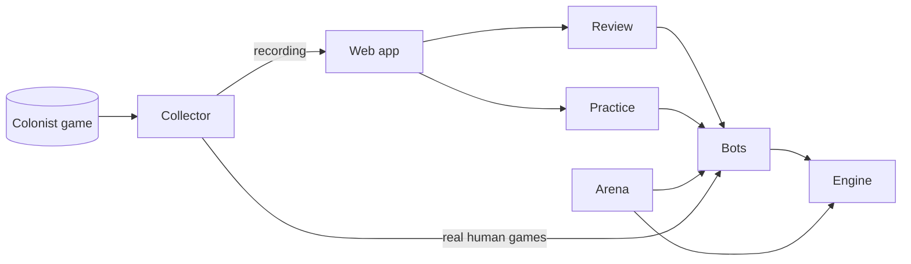

# Project Mayflower: Vision

**Team:** Mayflower: Noah Levine, Caleb Weisgerber, Ryan Massenburg, Emmett Oliver
**Status:** Draft for team agreement.

---

## 1. One-liner

**Chess.com Game Review, for Catan.** Record own games, upload it, and see which moves were good/ bad and *why*.

## 2. Why this project

There is no way to easily tell a **bad decisions** from **bad luck**. Did you lose because of the dice, or because you built a road when you should have bought a dev card?

## 3. What the user gets

- **Game review.** Record a game with our Collector, upload it, and get a move-by-move review. Can either use the chess.com labels (best, good, inaccuracy, mistake or blunder), **see Section 4 REVIEW**
  - **Setup placements:** your opening settlements and roads
  - **Build choices:** road vs. settlement vs. city vs. dev card, or holding
  - **Expansion direction:** where you should have grown
  - **Trades:** did it help or hurt you, and did overpay/ give to much value?
  - **Robber and knights:** where to place, whom to steal from, when to play
- **What-if.** Freeze any turn, try a different move, and watch how it typically plays out.
- **Your patterns.** Across all your uploaded games, the habits that cost you wins most often. For example: "you undervalue ports", "you trade with the leader too often", "you hold dev cards too long".
- **Practice.** Play against our bots in 4-player games, at easy, medium or hard.

## 4. What we're building

| Part | What it does |
| --- | --- |
| **Collector** | Chrome extension that records your own Colonist games. Read-only, and data stays on your computer. *Already built and tested on real games.* |
| **Engine** | Our own Catan rules engine, clean room coded from github. Everything else runs on it. |
| **Bots** | Several approaches, compared against each other over 3 quarters: search with heuristics, and self-play reinforcement learning. 4-player first. |
| **Bot personalities** | Configurable play styles (aggressive, trader, grudge-holder, and so on) so bots feel like real, unpredictable players. |
| **Arena** | Bot vs. bot tournaments with Elo ratings, plus matches against outside bots like Catanatron. |
| **Review** | Explains each move four ways: win-chance change, the bot's top alternatives, the factors involved (production, dice odds, ports, longest road, the leader's threat), and simulated play-outs. |
| **Trade valuation** | Scores a trade by what it does for you, weighed against how much it helps the table leader. |
| **Table talk** | The bot chooses whether to talk and what to say. Messages are structured intents such as "propose trade", "red is winning", "I'm not a threat", "team up against the leader", and **stay quiet** (talking can get you targeted). Either will be a mix of pre-written messages or LLM that that gets game state and ouputs a "natural" chat. |
| **Web app** | Upload, review and practice, all in one place. |

## 5. The hard part

Catan isn't chess:

- Cards are **hidden**.
- **Dice** swing everything.
- **Human players** are unpredictable and sometimes play for revenge.

How we deal with it:

- **Grade the decision, not the outcome.** Every score is averaged over many possible dice rolls and hidden hands.
- **Show confidence.** When two moves are statistically close, we say "about equal" instead of calling one a mistake.
- **Learn from real people.** Recorded games, chat included, show how humans actually play. Bot personalities and opponent models are built from them.
- **No false promises.** Catan can't be "solved." The bot gives strong, explainable advice, not perfect answers.

## 6. Research questions

Building the product is only half the project. The other half is answering questions nobody has answered well for Catan:

| Track | Question | How we answer it |
| --- | --- | --- |
| **Bot comparison** | Which algo/ approach plays Catan best: AlphaBeta(game-tree decision search), Monte Carlo Tree Search aka MCTS (search tree made with simuations), AlphaZero-style( MCTS with NN), PPO (policy based reinforcement learning), or imitation learning from recorded games? | Every approach runs on our engine under the same rules and time limits, and plays the others in the arena. Results go in a write-up. |
| **Negotiation** | Does table talk change who wins? Does staying quiet really avoid getting targeted? Can a bot talk the table into stopping the leader? | Bots with and without talk (pre-written and or LLM) play thousands of games against each other. We compare win rates and how often the leader gets targeted. |
| **Does the review help?** | Do players get better after using reviews? Do strong players agree with our "blunder" labels? | A user study. Players play, get reviews, then play again, and we measure the change. Experienced players rate a sample of our labels. |
| **Are the numbers honest?** | When we say "30% to win," does that player win about 30% of the time? | Compare predicted win chances with real outcomes from recorded and simulated games. |

These tracks need data, so the Collector also builds our **dataset of real games**: our own, plus opt-in games from friends. (THIS IS THE BIGGEST ISSUE. HOPFULY WE CAN JUST RUN EVEN SIMULATED GAMES TO SUPPLEMENT)

## 7. Roadmap

| Phase | Goals |
| --- | --- |
| **1: Walking skeleton** | Collector. Engine core works. Recorded games replay correctly in the engine. Build one bot to explore how everything works. **First review feature: setup placements** (the opening optimizer). Negotiation: define the message intents and add them to the engine. Start recording every game each one of us play. |
| **2: MVP** | First learning bot(choice between the different choices). Bot play each other to make simulated games, which fill in for our small set of real games. Review of builds, robber/knights and dev cards. Practice mode (4-player). Saved reviews and sessions. Negotiation: first talk vs. no-talk experiments. First check of whether the win-chance numbers are honest. |
| **3: Extensions & results** | Bot comparison write-up. Review user study. "Your patterns" across games. Trade valuation and player-to-player trades. Table talk with pre-written messages and/or an LLM. Bot personalities. What-if branching. |

Starting with setup placements is a proposal. The whole board is visible, no cards are hidden yet, and it's the easiest decision to grade reliably.

**Real-world check (from Phase 2):** we play Colonist games where a human makes the moves our bot suggests, to see how it holds up against real people. The bot never clicks on Colonist itself.

**About data:** simulated games are great for training bots, since they're free and unlimited. But some things still need real human games: the user study, checking the win-chance numbers on real players, and "your patterns." So we record every game we play from Phase 1 on.

## 8. How we work

- Everything runs locally at **$0** first, explore use of Docker. Cloud GPU or google coloab can come later if needed.
- Every change goes through a **pull request** (a proposed change on GitHub) with at least one teammate's review and passing automated tests.
- **No secrets in git** (passwords, API keys); keep them in `.env` files that never get uploaded.
- Heavy analysis runs as **background jobs**, so the website never freezes while a review is computed.
- Users get **in-app help**: tooltips that explain terms like win chance, plus a short guide to reading a review.
- Compute: build and train on our own compute first. If that isn't enough, use Google Colab or another cloud service for training runs or testing.

## 9. What we're not doing

- Online multiplayer between humans
- 1v1 games (4-player only for now)
- A bot that plays on Colonist by itself
- Expansions (Cities & Knights, Seafarers, 5–6 players)
- Mobile apps
- Open-ended chatbot conversation unrelated to the game

## 10. What changed from earlier drafts, and why

| Earlier draft | This vision | Why |
| --- | --- | --- |
| No scraping or reverse-engineering of game platforms | The Collector is in scope: read-only, your own games only | Reviewing your own games requires recording them, and writing every move down by hand isn't realistic |
| Use an open-source engine as a black box | Write our own clean-room engine  | We need full control over rules, hidden information and speed optimations for training and review |
| The opening optimizer is the core product | The opening optimizer is the **first** review feature, then the rest of the game | Keeps the idea and grows it into full game review |

Everything else from the earlier drafts is kept: the chess.com comparison, the three phases, what-if branching, trade valuation against the leader, structured table talk, bot personalities, "about equal" tie warnings, local-first Docker, the PR rules and the out-of-scope list.

## 11. Open questions for the team

1. What language should the engine use?
2. Which review area comes after setup placements?
3. Review labels: do we use chess.com's labels (best, good, inaccuracy, mistake, blunder) or our own? (See Section 3.)
4. Table talk: pre-written messages, an LLM, or a mix?
5. Data (the biggest risk): how many real games can we realistically record, and how much can simulated games make up for?

## 12. Inspiration

- **Catanatron:** open-source Catan simulator and bots (github.com/bcollazo/catanatron)
- **canopy:** AlphaZero-style Catan bot (github.com/cullback/canopy)
- **Chess.com Game Review / Lichess analysis:** the experience we're aiming for
- **AlphaZero** (Silver et al., 2017): the self-play + MCTS approach that mastered chess and Go
- **Information Set MCTS** (Cowling, Powley & Whitehouse, 2012): MCTS for games with hidden cards
